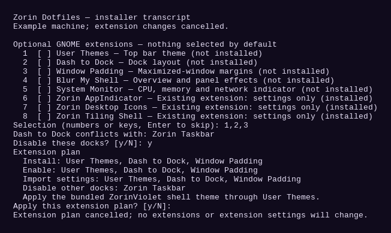

# Zorin Violet dotfiles

Configuration files for Kitty, Bash, Wofi, GTK 3 and GTK 4, the ZorinViolet shell theme, and optional preferences for GNOME extensions. Nautilus shares the GTK styling.

## Installation

Copy the entire repository, including its hidden `.config` and `.local` folders. Open a terminal in it, preview the plan, then run the installer as your regular desktop user:

```sh
python3 install.py --dry-run
python3 install.py
```

The installer first lists the optional extensions. **Nothing is selected by default.** Enter menu numbers or extension keys separated by commas/spaces, or press Enter to skip every extension change. After making a selection, review the exact installation, activation, preference-import and dock-replacement plan. Only `y` or `yes` at the final confirmation applies that extension plan. No, empty input, or EOF cancels the extension plan; the ordinary dotfiles installation can still continue.

Application dependencies are installed through the distribution package manager: Kitty, Wofi, Nautilus, JetBrains Mono, Cousine (`fonts-croscore`), `wl-clipboard`, `dconf-cli`, and PyGObject. **The broad `gnome-shell-extensions` package is not installed.** User Themes and System Monitor are individual opt-in downloads, just like the other downloadable extensions.

Existing files are backed up under `${XDG_STATE_HOME:-$HOME/.local/state}/zorin-violet-dotfiles/backup-*`. The installer prints the exact directory. `new-files.txt` records configurations that did not previously exist. The theme and Bash prompt integration also have backups.

## Optional extension choices

Only the extensions you select are installed, enabled or configured. An already installed extension is not downloaded again.

1. **User Themes** (`user-theme`) — applies the bundled top bar theme.
2. **Dash to Dock** (`dash-to-dock`) — dock layout.
3. **Window Padding** (`window-padding`) — margins around maximized windows.
4. **Blur My Shell** (`blur-my-shell`) — overview and panel effects.
5. **System Monitor** (`system-monitor`) — CPU, memory and network indicator.
6. **Zorin AppIndicator** (`zorin-appindicator`) — import preferences only if already installed.
7. **Zorin Desktop Icons** (`zorin-desktop-icons`) — import preferences only if already installed.
8. **Zorin Tiling Shell** (`zorin-tiling-shell`) — import preferences only if already installed.

Downloads come from `extensions.gnome.org`, with the package UUID and GNOME version checked before installation. The three Zorin extensions are not downloaded by this installer.

The installer separately asks before disabling an enabled Zorin Taskbar, Zorin Dash, or Ubuntu Dock in favor of Dash to Dock. Declining keeps those docks unchanged; Dash to Dock can be installed and configured but is not enabled. Only the conflicting docks listed in the approved plan are disabled.

The global Extensions master switch is preserved. If it is off, the installer tells you to turn it on yourself in Extensions. It does not activate unrelated extensions by changing that switch.

The bundled theme files are copied with the dotfiles, but the shell theme is selected/reloaded only when **User Themes** is explicitly selected. Other extensions and their preferences remain unchanged. This installer does not install Violet Windows, Virtualbox IPs, Pangolin Status, or a GDM extension.

## Screenshots

The following is a transcript rendered from the real selection code using an example machine state. The final extension plan was cancelled; no extensions were installed to create this image.



## Command-line options

- `--dry-run`: show a plan without prompts, downloads, package installation or writes. An extension plan is empty unless `--extensions` is supplied.
- `--extensions user-theme,dash-to-dock`: explicitly select keys or displayed menu numbers. A final confirmation is still required unless `--yes` is supplied.
- `--yes`: confirm the explicit selection. **It never selects all extensions** and does not authorize replacing another dock.
- `--replace-dock`: explicitly permit disabling listed conflicting docks when selecting Dash to Dock.
- `--skip-extensions`: skip all extension downloads, activation, theme selection and saved extension preferences. It cannot be combined with `--extensions`.
- `--skip-packages`: skip application packages and extension downloads. Selected extensions can still be enabled/configured if already installed.
- `--skip-extension-settings`: skip saved preference imports. Selected extensions can still be installed/enabled; selecting User Themes still selects the bundled shell theme.
- `--check`: display the installed theme and extension status without changing anything.

Examples:

```sh
# Apply only dotfiles, leaving GNOME extension settings and activation unchanged.
python3 install.py --skip-extensions

# Preview an explicit choice without making changes.
python3 install.py --dry-run --extensions user-theme,window-padding

# Explicit, unattended opt-in to these two extensions only.
python3 install.py --extensions user-theme,window-padding --yes

# Separately authorize replacing an enabled conflicting dock.
python3 install.py --extensions dash-to-dock --replace-dock --yes
```

Restart Kitty and Wofi afterward. Log out and back in when adding GNOME extensions so Shell can discover their files.

## Included extension preferences

Saved preferences live in `.config/gnome-extension-settings`. The catalog and UUIDs are documented in `extension_options.py`. A preference file is imported only if its extension is selected and available. The installer backs up its old dconf settings before importing it.

To restore a preference, open the relevant backup folder and use the corresponding dconf path. For example:

```sh
dconf reset -f /org/gnome/shell/extensions/dash-to-dock/
dconf load /org/gnome/shell/extensions/dash-to-dock/ < extension-settings/dash-to-dock.dconf
```

Activation changes are backed up in `enabled-extensions.txt`, `disabled-extensions.txt`, and `disable-user-extensions.txt`. The global switch itself is not changed. Restore ordinary configuration files from the backup's `.config` folder, and restore `.bashrc` from its backup to undo the prompt integration.

## Shell theme and dock appearance

The complete ZorinViolet theme is bundled under `.local/share/themes/ZorinViolet`. The top bar styles are in its `gnome-shell/gnome-shell.css`. Copy this hidden directory when moving the dotfiles to another machine.

Select User Themes to apply this theme. For the matching dock, also select Dash to Dock and import its preferences. The dock has 16-pixel rounded corners and violet borders. Its Blur My Shell dock layer is disabled in the saved preferences, avoiding a rectangular surface behind the rounded background. Rounded Window Corners is not required.

If the theme does not appear after login, run:

```sh
python3 install.py --check
```

The output shows the theme file, selected theme name, Extensions master switch, and extension status. A theme under `~/.themes` takes precedence over `~/.local/share/themes`; check for an older copy if the wrong stylesheet is selected.

## Window gaps

Select **Window Padding** for margins around maximized windows and **Zorin Tiling Shell** for saved tiling gaps, if the latter is installed. Neither is selected automatically.

Saved Window Padding values are 4 pixels at the top and 8 pixels at the other screen edges. Tiling Shell uses 4 pixels for both inner and outer gaps. Physical monitor connector names are excluded so a VM can use its own display.

## GDM wallpaper synchronization

Install Violet Windows separately with its own `install.sh`. In its preferences choose **Enable sync**, review the listed GDM component, then explicitly approve **Install and enable** before administrator authorization. The terminal alternative is:

```sh
sudo python3 install-gdm.py --sync-wallpaper
```

That installer has its own default-No confirmation. It installs the GDM background component only after approval; this dotfiles installer never installs it.

## Kitty font and Bash prompt

Kitty uses `current-theme.conf` and the Cousine font, supplied by `fonts-croscore`. The two-line colored prompt is stored in `.config/bash/violet-prompt.sh`.

The installer backs up `~/.bashrc` and adds a marked block sourcing that file. Running it again updates the same block. To undo the prompt integration, restore `.bashrc` from backup or remove the marked block.

## Development and tests

- `extension_options.py` contains the catalog, input handling and immutable plans. It performs no I/O except the explicitly supplied prompt/output functions and never runs installation commands.
- `install.py` applies only the confirmed plan.
- `tests/test_extension_consent.py` covers default-No behavior, selection, existing extensions, skipped settings, and separate dock consent.
- `tests/test_activation.py` checks actual GNOME settings using the in-memory backend and installs dotfiles only into temporary folders.

Run the tests without modifying your desktop settings:

```sh
GSETTINGS_BACKEND=memory python3 -B -m unittest discover -s tests -v
```

The activation tests refuse to run against a persistent settings backend. The unit tests make no network requests or package installations.
